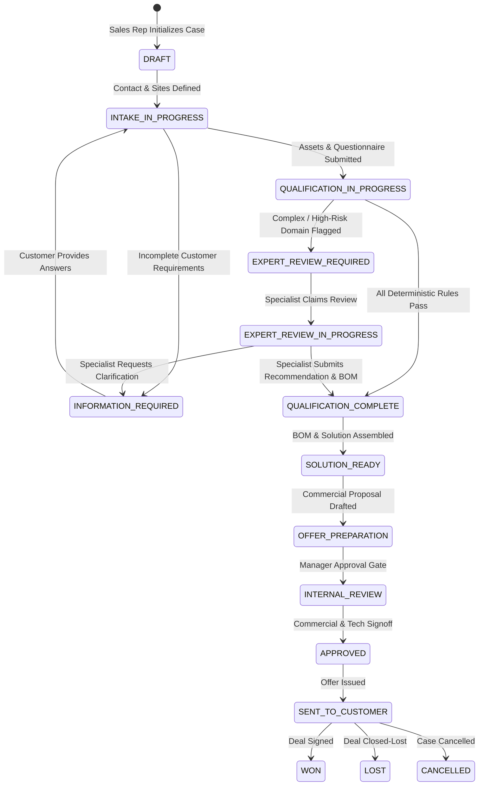

# Architecture & System Design Document
## TelcoQualify Enterprise — Telecom Commercial Solution-Qualification & Presales Platform

---

### 1. System Overview & Executive Summary

**TelcoQualify Enterprise** is an enterprise-grade commercial intelligence, solution-qualification, and presales workflow platform specifically engineered for telecommunications service providers (ISPs and Telcos) serving SMB, SME, and enterprise business accounts.

The platform bridges the gap between front-office commercial sales representatives and back-office specialized engineering teams (Network, UCaaS/Telephony, Cybersecurity, and Provisioning). It automates deterministic eligibility, compatibility, and sizing evaluations against a configurable product catalog while routing non-deterministic, high-risk, or complex technical scenarios to authorized domain experts.

---

### 2. High-Level Component Diagram

```mermaid
graph TD
    subgraph Client Tier
        UI[Next.js 14 Responsive Web App]
        i18n[Bilingual i18n Store - FR / EN]
        DesignSystem[Design System & Dynamic Form Engine]
    end

    subgraph Security & Gateway Tier
        WAF[WAF / Reverse Proxy]
        AuthGuard[JWT & Session Guard / RBAC Policy Engine]
        SecHeaders[Strict CSP / HSTS / X-Frame Headers]
    end

    subgraph Core Application & Domain Services
        CaseMgr[Customer Case Manager & State Machine]
        QuestEngine[Extensible Dynamic Questionnaire Engine]
        AssetInv[Existing Asset & Environment Delta Tracker]
        QualEngine[Deterministic Qualification Engine]
        ExpertWorkflow[Specialist Expert Escalation & Review Workflow]
        BOMGenerator[Multi-Domain Bill of Materials (BOM) Engine]
        OfferPrep[Technical Brief & Commercial Offer Preparer]
        DocIntake[Secure Document Intake & Sanitization Engine]
        AuditLogger[Immutable Cryptographic Audit Logger]
        CatalogService[Configurable Product & Rules Catalog]
    end

    subgraph Persistence & Infrastructure Tier
        DB[(PostgreSQL 16 / SQLite Engine)]
        DocStore[(Private Encrypted Object Storage)]
        RedisCache[(Redis Cache & Job Queue)]
    end

    UI --> WAF
    WAF --> AuthGuard
    AuthGuard --> CaseMgr
    CaseMgr --> QuestEngine
    CaseMgr --> AssetInv
    CaseMgr --> QualEngine
    QualEngine --> CatalogService
    CaseMgr --> ExpertWorkflow
    CaseMgr --> BOMGenerator
    BOMGenerator --> OfferPrep
    CaseMgr --> DocIntake
    CaseMgr --> AuditLogger
    
    CaseMgr --> DB
    CatalogService --> DB
    AuditLogger --> DB
    DocIntake --> DocStore
```

---

### 3. Case Lifecycle & State Machine

Cases follow a deterministic, auditable state machine:



---

### 4. Qualification Engine Architecture

The Qualification Engine does **not guess or invent capabilities**. It operates deterministically:

$$\text{Customer Requirements} + \text{Existing Assets} + \text{Catalog Rules} \xrightarrow{\text{Rule Engine}} \text{Qualification Result} + \text{Explanations} + \text{Flags}$$

#### Qualification Outputs:
1. **AVAILABLE**: Fully supported by current catalog and topology.
2. **RENEWAL_RECOMMENDED**: Existing equipment license/contract nearing expiration.
3. **UPGRADE_REQUIRED**: Existing equipment bandwidth/capacity insufficient.
4. **REPLACE_RECOMMENDED**: Existing hardware is End-of-Life (EOL) or incompatible with target service (e.g., legacy ISDN PBX migrating to SIP Trunk).
5. **EXPERT_VALIDATION_REQUIRED**: Advanced topology (e.g. multi-site BGP mesh, Next-Gen Firewall SSL-Inspection sizing, redundant dark fiber).
6. **INCOMPATIBLE**: Hard constraint violation (e.g. requesting 1Gbps symmetrical on copper line).
7. **MISSING_INFORMATION**: Mandatory inputs not provided.

Every qualification item contains:
- **Status Badge**: Clear visual indicator.
- **Rule Identifier**: E.g. `RULE-SEC-FW-RENEW-01`.
- **Transparent Explanation**: Explaining *why* the conclusion was reached.
- **Actionable Next Steps**: Automatically suggested BOM component or expert dispatch.

---

### 5. Specialist Expert Review Workflow

When deterministic rules cannot resolve a requirement, the case escalates to domain-specific specialists:
- **Telephony & UCaaS Expert Team**
- **Network, WAN & SD-WAN Expert Team**
- **Cybersecurity & Firewall Expert Team**
- **Presales Solutions Architect**

#### Expert Separation of Concerns:
- **Confidential Internal Notes**: Highly technical diagnostics visible **only** to engineers with the corresponding expert or admin role.
- **Client-Safe Recommendation**: Synthesized technical summary exposed to commercial sales agents.
- **Expert BOM Contribution**: Authoritative hardware/service line items added directly to the case's Bill of Materials.

---

### 6. Information Classification & Granular Access Control

All data entities carry an Information Classification level:
1. `PUBLIC / GENERAL`: Marketing catalog, standard product sheets.
2. `INTERNAL`: Standard case metadata, commercial notes, customer site names.
3. `CUSTOMER_CONFIDENTIAL`: Customer pricing, contact info, contract terms.
4. `RESTRICTED`: System configurations, audit logs.
5. `SECURITY_SENSITIVE`: Detailed firewall ACL rules, internal IP topologies, expert security notes.

Access is strictly enforced at the backend service layer via Resource-Action-Classification evaluation.
