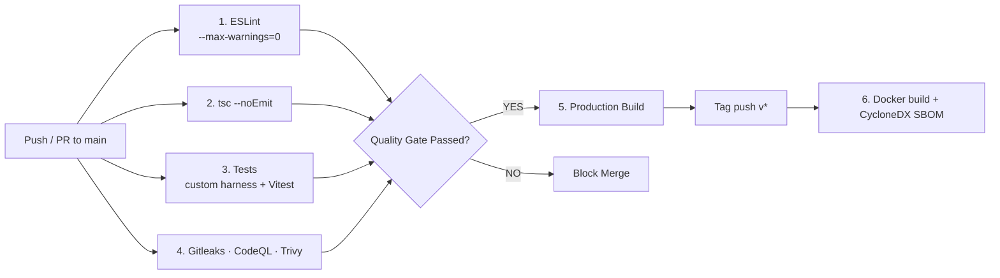

# CI/CD Pipeline & Quality Gate Specification
## Automated DevSecOps, Continuous Integration & Deployment

---

### 1. Multi-Stage Pipeline Overview

Four GitHub Actions workflows run against the repository's GitHub default
branch **`main`**. (Correction from the original audit: the local working
copy had been left on a local-only `master` branch with no remote, but the
public repo's default branch is `main` — which the historical runs confirm.
`develop` never existed. GitHub's run history shows the CI Quality Gate
failed 3/3 times for a missing ESLint config, the Security pipeline passed
only because Trivy was non-gating, and the daily audit failed 25/25 days on
open CVEs. See `docs/audits/CI-CD-AUDIT.md` for the full record.)

### 2. What Each Gate Actually Runs

| Gate | Workflow | Command | Fails on |
|------|----------|---------|----------|
| Typecheck | `ci.yml` | `npm run typecheck` | any TS error (incl. generated `.next/types`) |
| Lint | `ci.yml` | `npm run lint` (`eslint . --max-warnings=0`) | any error **or warning** |
| Tests | `ci.yml` | `npm run test` | custom harness failure (26 assertions) **or** Vitest failure (30 tests) |
| Build | `ci.yml` | `npm run build` | any build error |
| Secrets | `security.yml` | `gitleaks/gitleaks-action@v2` | any leaked credential |
| SAST | `security.yml` | `github/codeql-action` (javascript-typescript) | analysis errors; findings surface in the repo Security tab (upload does not block) |
| Dependencies | `security.yml` | `aquasecurity/trivy-action@v0.36.0` (pinned) | **CRITICAL/HIGH findings** (`exit-code: '1'`), SARIF still uploaded |
| Daily audit | `daily-security.yml` | `node scripts/audit-gate.mjs` (04:00 UTC) | new high/critical advisories not listed in `/.trivyignore` (accepted-risk aware) |
| Release | `release.yml` | Docker build (no push) + CycloneDX SBOM | build failure on `v*` tags |

No workflow step uses `continue-on-error` or `|| true`.

### 3. Known Pipeline Gaps (tracked in `docs/audits/CI-CD-AUDIT.md`)

- **No E2E stage.** Playwright and staging deployment/smoke-test stages in
  earlier revisions of this document were aspirational — no E2E runner, no
  staging environment, and no deployment automation exist.
- **No container image scan.** Trivy runs a filesystem scan of the repo; the
  release workflow builds the Docker image but does not scan it before
  (not) publishing. Add `scan-type: image` when a registry push is
  introduced.
- **No Semgrep.** Only CodeQL performs SAST.
- **Badges were stale until the post-remediation push** — this working copy
  had no remote configured (now pushed to `main`).
- **Docker build is untested in CI.** `ci.yml` verifies `npm run build` on
  the host; the Dockerfile itself is only exercised by `release.yml` on tags.
