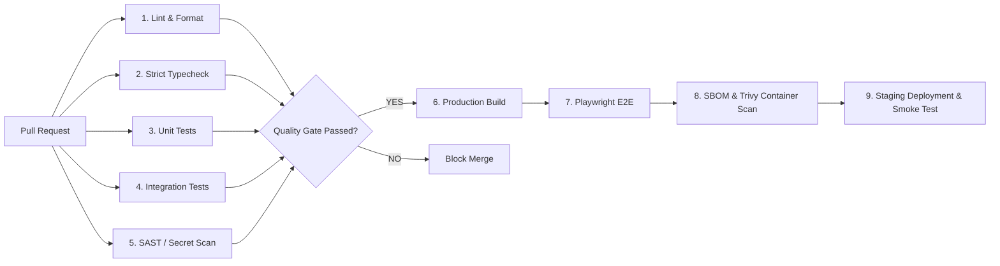

# CI/CD Pipeline & Quality Gate Specification
## Automated DevSecOps, Continuous Integration & Deployment

---

### 1. Multi-Stage Pipeline Overview

Every Pull Request and release candidate triggers an automated quality gate in GitHub Actions:

---

### 2. Security Workflows Included
1. **Gitleaks / Secret Scanning**: Detects accidental commits of private keys, AWS/Azure tokens, or database passwords.
2. **CodeQL & Semgrep (SAST)**: Static Application Security Testing for SQL injection, insecure deserialization, IDOR, and XSS.
3. **Trivy Container & Dependency Scanning**: Scans container layers and package dependencies against OSV and CVE vulnerability databases.
4. **CycloneDX SBOM Generation**: Software Bill of Materials generation on every release tag.
5. **Nightly Vulnerability Audit**: Scheduled 04:00 UTC pipeline scanning all dependencies for newly published 0-days.
