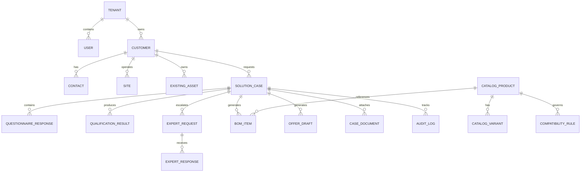

# Database Architecture & Schema Specification
## TelcoQualify Enterprise Data Model

---

### 1. Entity-Relationship Diagram (ERD)

---

### 2. Core Entities & Table Definitions

#### A. `Customer`
- `id` (UUID, Primary Key)
- `companyName` (VARCHAR 255, Indexed)
- `sirenOrVat` (VARCHAR 64, Unique)
- `industrySegment` (ENUM: `SMB`, `PME`, `PMI`, `ENTERPRISE`, `PUBLIC_SECTOR`)
- `accountManagerId` (UUID -> User)
- `createdAt`, `updatedAt`

#### B. `Site`
- `id` (UUID, PK)
- `customerId` (UUID -> Customer)
- `siteName` (VARCHAR 128)
- `addressLine1`, `postalCode`, `city`, `country`
- `buildingType` (ENUM: `OFFICE_HQ`, `BRANCH_OFFICE`, `WAREHOUSE`, `RETAIL_STORE`)
- `floorsCount`, `areaSquareMeters`
- `totalStaffCount`

#### C. `ExistingAsset` (Customer Baseline)
- `id` (UUID, PK)
- `customerId` (UUID -> Customer)
- `siteId` (UUID -> Site)
- `category` (ENUM: `FIREWALL`, `ROUTER`, `SWITCH`, `PBX`, `SIP_TRUNK`, `WIFI_AP`, `INTERNET_LINK`)
- `manufacturer`, `model`, `serialNumber`
- `installDate`, `warrantyExpiryDate`
- `licenseStatus` (ENUM: `ACTIVE`, `EXPIRING_SOON`, `EXPIRED`, `UNLICENSED`)
- `currentCapacityOrBandwidth` (VARCHAR 64)

#### D. `SolutionCase`
- `id` (UUID, PK)
- `caseNumber` (VARCHAR 32, Unique, e.g. `CASE-2026-0042`)
- `customerId` (UUID -> Customer)
- `assignedCommercialId` (UUID -> User)
- `lifecycleState` (ENUM: `DRAFT`, `INTAKE_IN_PROGRESS`, `INFORMATION_REQUIRED`, `QUALIFICATION_IN_PROGRESS`, `EXPERT_REVIEW_REQUIRED`, `QUALIFICATION_COMPLETE`, `SOLUTION_READY`, `OFFER_PREPARATION`, `APPROVED`, `WON`, `LOST`)
- `priority` (ENUM: `LOW`, `NORMAL`, `HIGH`, `URGENT`)
- `classification` (ENUM: `INTERNAL`, `CUSTOMER_CONFIDENTIAL`, `RESTRICTED`)
- `version` (INT, Optimistic Concurrency Control)
- `createdAt`, `updatedAt`

#### E. `ExpertRequest` & `ExpertResponse`
- `id` (UUID, PK)
- `caseId` (UUID -> SolutionCase)
- `domain` (ENUM: `TELEPHONY`, `NETWORK_SDWAN`, `CYBERSECURITY_FIREWALL`, `SOLUTIONS_ARCHITECT`)
- `status` (ENUM: `OPEN`, `ASSIGNED`, `IN_PROGRESS`, `CLARIFICATION_REQUESTED`, `COMPLETED`, `REJECTED`)
- `priority` (ENUM: `NORMAL`, `HIGH`, `URGENT`)
- `assignedExpertId` (UUID -> User, Nullable)
- `questionText` (TEXT)
- `clientSafeRecommendation` (TEXT)
- `internalNotes` (TEXT, `SECURITY_SENSITIVE`)
- `suggestedBomItemsJson` (JSONB)

#### F. `AuditLog` (Immutable)
- `id` (UUID, PK)
- `caseId` (UUID, Nullable, Indexed)
- `actorId` (UUID -> User)
- `actorName` (VARCHAR 128)
- `actorRole` (VARCHAR 64)
- `action` (VARCHAR 64, e.g. `CASE_STATE_CHANGED`, `EXPERT_REVIEW_SUBMITTED`, `DOCUMENT_UPLOADED`)
- `resource` (VARCHAR 64)
- `resourceId` (VARCHAR 64)
- `previousStateJson` (JSONB, Nullable)
- `newStateJson` (JSONB, Nullable)
- `ipAddress` (VARCHAR 45)
- `correlationId` (UUID)
- `createdAt` (TIMESTAMP WITH TIME ZONE, Immutable)
